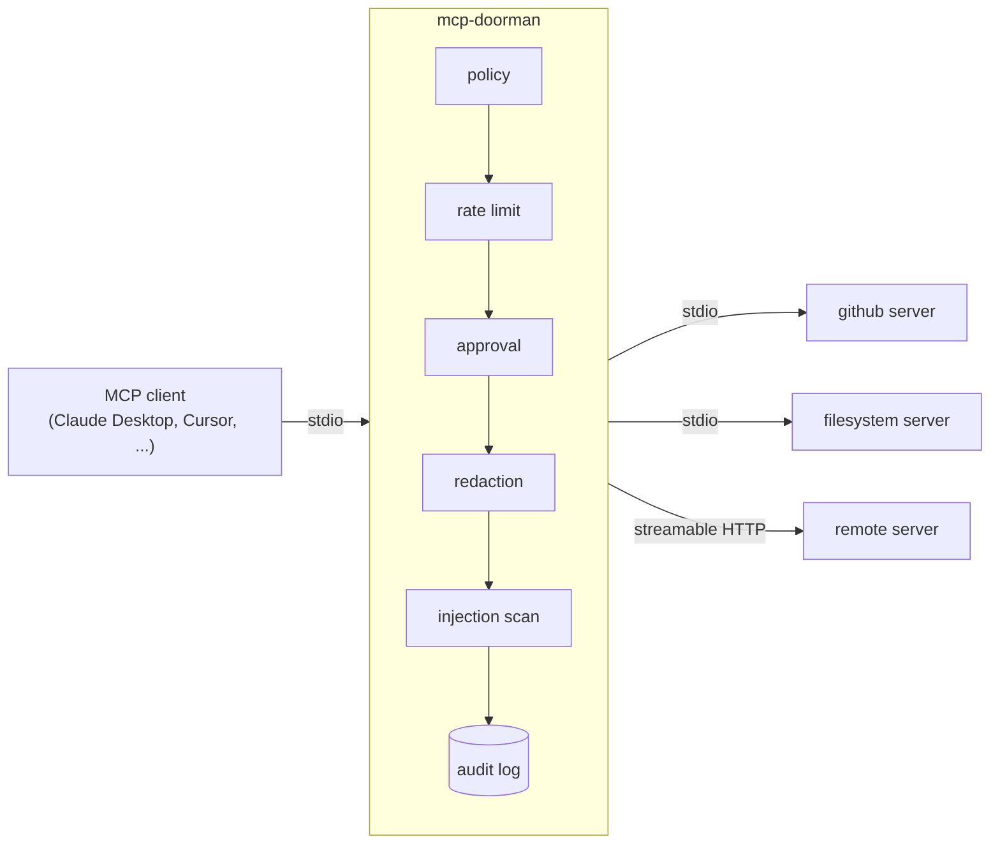

# mcp-doorman

**The security gateway for MCP servers — every tool call gets checked at the door.**

[](https://github.com/YOUR_GITHUB_USERNAME/mcp-doorman/actions/workflows/ci.yml)
[](https://www.npmjs.com/package/mcp-doorman)
[](LICENSE)
[](CONTRIBUTING.md)

`mcp-doorman` is a drop-in proxy that sits between your AI agent (Claude Desktop, Claude Code, Cursor, VS Code, any MCP client) and the MCP servers it uses. One command, zero infrastructure, and every `tools/list` and `tools/call` passes through a guard pipeline:

- 🛂 **Policy engine** — allow / deny / require-approval rules per tool, glob-matched
- 🕵️ **Secret redaction** — AWS keys, GitHub/Slack/Stripe/OpenAI/Anthropic tokens, private keys, JWTs, cards (Luhn-checked)… scrubbed from tool results *before* they reach the model
- 💉 **Prompt-injection screening** — flags or blocks tool results (and tool *descriptions* — tool poisoning) that try to instruct the model
- 📌 **Rug-pull detection** — tool definitions are hash-pinned on first use; if a server silently swaps a description, the tool is blocked until a human re-pins it
- 🚦 **Rate limiting** — per-tool token buckets cap the blast radius of a runaway agent loop
- 🙋 **Human approval gates** — sensitive tools trigger an interactive approval prompt via [MCP elicitation](https://modelcontextprotocol.io/specification/draft/client/elicitation), right in your client
- 🧾 **Audit log** — every call, denial, redaction, and flag lands in an append-only JSONL file

## Why this exists

Everyone is one `npx some-random-mcp-server` away from handing an unvetted process their API keys and a direct line into their model's context window. The documented attack classes are real, not hypothetical:

| Attack | How it works |
|---|---|
| **Tool poisoning** | Malicious instructions hidden in a tool's *description*, invisible in most client UIs |
| **Rug pull** | Server presents innocent tools on day 1, swaps the definitions after you've approved them |
| **Indirect prompt injection** | A webpage/issue/email fetched by a *legitimate* tool carries instructions aimed at the model |
| **Secret exfiltration** | A leaked credential in one tool result + one injected instruction = your key on someone else's server |
| **Runaway loops** | A confused or hijacked agent mass-deletes, mass-mails, mass-scrapes |

Enterprise MCP gateways exist for platform teams with Kubernetes clusters. **Nothing lightweight guards the individual developer's laptop — the place where 99% of MCP servers actually run.** That's the gap this project fills.

## Quickstart (60 seconds)

```bash
# 1. Create a config
npx -y mcp-doorman init

# 2. Edit doorman.config.json — put your real servers in it

# 3. Pin the current tool definitions (trust on first use)
npx -y mcp-doorman pin --config doorman.config.json
```

Then point your client at the gateway **instead of** your servers. Claude Desktop / Claude Code / Cursor:

```jsonc
// BEFORE — every server talks straight to the model
{
  "mcpServers": {
    "github":     { "command": "npx", "args": ["-y", "@modelcontextprotocol/server-github"] },
    "filesystem": { "command": "npx", "args": ["-y", "@modelcontextprotocol/server-filesystem", "/repos"] }
  }
}

// AFTER — one doorman guards them all
{
  "mcpServers": {
    "doorman": {
      "command": "npx",
      "args": ["-y", "mcp-doorman", "run", "--config", "/absolute/path/to/doorman.config.json"]
    }
  }
}
```

Tools show up namespaced as `github__create_issue`, `filesystem__read_file`, etc., plus two built-ins: `doorman__status` and `doorman__recent_events` (ask your agent *"what did doorman block recently?"*).

> **Windows note:** if a server entry uses `npx` directly, spawn it through cmd: `"command": "cmd", "args": ["/c", "npx", "-y", "..."]`.

## See it work

```bash
git clone https://github.com/YOUR_GITHUB_USERNAME/mcp-doorman && cd mcp-doorman
npm install
npm run demo
```

The demo wires the gateway to a deliberately misbehaving server ([examples/demo-server.mjs](examples/demo-server.mjs)) that leaks fake credentials, serves a prompt-injection payload, and offers a destructive tool — and shows each guard catching it.

## How it works



The gateway is an MCP **server** toward your client and an MCP **client** toward every upstream (stdio child processes or streamable-HTTP endpoints), aggregating them behind one connection. It is built on the official [TypeScript SDK](https://github.com/modelcontextprotocol/typescript-sdk).

## Configuration

Everything lives in one JSON file. Full example with every option:

```jsonc
{
  "servers": {
    "github": {
      "command": "npx",
      "args": ["-y", "@modelcontextprotocol/server-github"],
      "env": { "GITHUB_PERSONAL_ACCESS_TOKEN": "${GITHUB_TOKEN}" }   // ${VAR} = read from gateway env
    },
    "remote": { "url": "https://mcp.example.com/mcp", "headers": { "Authorization": "Bearer ${MCP_TOKEN}" } }
  },

  "policy": {
    "defaultAction": "allow",                    // "allow" | "deny" | "approve"
    "rules": [                                   // first match wins, evaluated top-down
      { "match": "*__delete*",  "action": "deny",    "reason": "no destructive tools" },
      { "match": ["github__create_*", "*__send_*"], "action": "approve" },
      { "match": "filesystem__*", "action": "allow" }
    ]
  },

  "redaction": {
    "enabled": true,
    "disable": [],                               // built-in rule names to turn off
    "enableOptIn": ["email"],                    // opt-ins: "email", "us-ssn", "ipv4"
    "custom": [{ "name": "acme-id", "pattern": "ACME-[0-9]{6}" }],
    "redactArguments": false                     // also scrub model-supplied arguments
  },

  "injection": {
    "action": "flag",                            // "flag" (warn the model) | "block" | "off"
    "scanToolDescriptions": true,                // tool-poisoning check on tools/list
    "custom": []
  },

  "pinning": {
    "enabled": true,
    "onNewTool": "pin",                          // "pin" (TOFU) | "block" (until `mcp-doorman pin`)
    "onChangedTool": "block"                     // "block" | "warn"
  },

  "rateLimit": { "perMinute": 120, "perTool": { "*__send_*": 5 } },

  "approval": { "fallback": "deny", "timeoutMs": 120000 },  // fallback when client lacks elicitation

  "audit": { "enabled": true, "includeArguments": true, "includeResults": false },

  "logLevel": "info"
}
```

Pin state and the audit log default to `<config-name>.pins.json` / `<config-name>.audit.jsonl` next to the config file.

### CLI

| Command | What it does |
|---|---|
| `mcp-doorman run --config <path>` | Start the gateway over stdio (default command) |
| `mcp-doorman pin --config <path>` | Connect to all upstreams and pin (trust) their current tool definitions |
| `mcp-doorman init` | Write a starter config with sensible defaults |

## Honest limitations

Security tooling that oversells is worse than none. Read this part.

- **Heuristics are bypassable.** The injection patterns catch documented, common attack shapes. A motivated attacker can phrase around any regex. Use `deny`/`approve` policies as the hard boundary; screening is defense-in-depth.
- **Redaction is best-effort.** Known token formats are caught reliably; a random hex secret with no context is not. Don't point agents at credential stores.
- **This is not a sandbox.** Upstream servers still run as child processes with your user's privileges. Doorman guards the *protocol*; pair it with containers ([ToolHive](https://github.com/stacklok/toolhive)-style) to guard the *process*.
- **TOFU trusts first sight.** Pinning detects *changes*, not tools that were malicious from day one — that's what the description scanner and your own review are for.
- **Approval gates need elicitation.** Clients without elicitation support fall back to `approval.fallback` (deny by default).

## Roadmap — help wanted 🙌

- [ ] `resources/*` and `prompts/*` proxying (currently tools-only)
- [ ] Pass-through for sampling and roots
- [ ] Community rule packs (`doorman-rules-finance`, `doorman-rules-healthcare`…)
- [ ] Learning mode: observe for a week, propose a least-privilege policy
- [ ] OPA / Cedar policy backends
- [ ] `mcp-doorman audit` subcommand: pretty-print and query the JSONL log
- [ ] Web dashboard for audit visualization
- [ ] Entropy-based generic secret detection

Grab anything above, or start with a [`good first issue`](https://github.com/YOUR_GITHUB_USERNAME/mcp-doorman/labels/good%20first%20issue). New detection rules are the easiest contribution: one regex + two tests. See [CONTRIBUTING.md](CONTRIBUTING.md) and [docs/detection-rules.md](docs/detection-rules.md).

## Development

```bash
npm install
npm test          # 69 tests: unit + full stdio e2e
npm run build
npm run demo      # watch the guards fire live
```

## License

[Apache-2.0](LICENSE) — free for any use, with an explicit patent grant.
